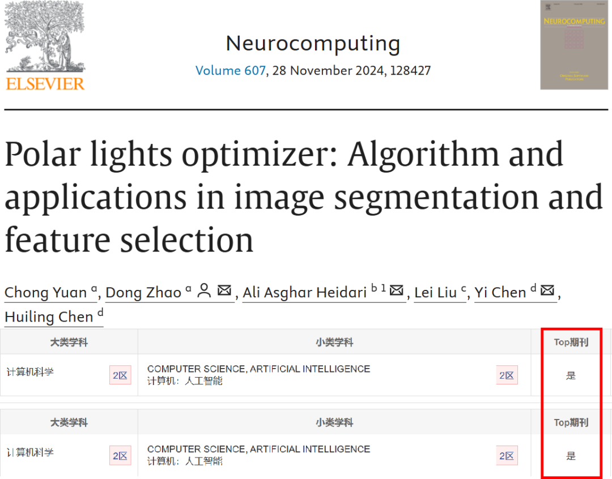
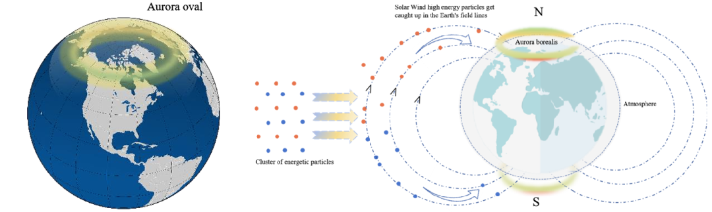
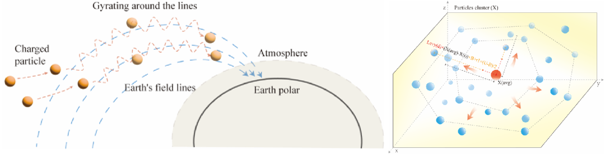
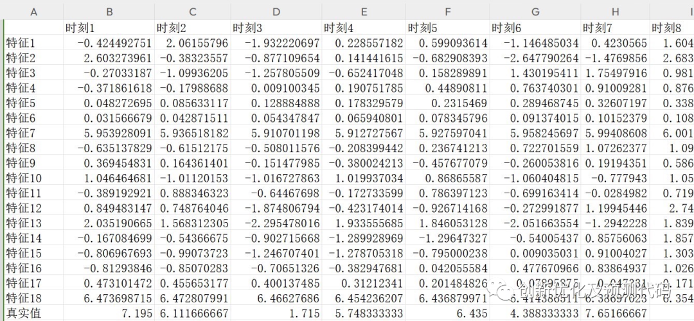
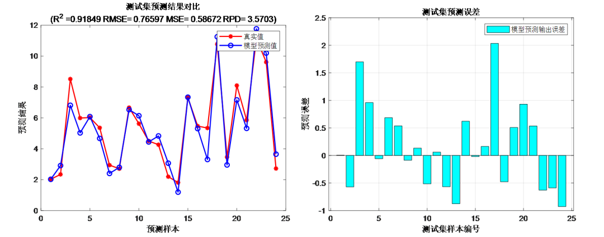
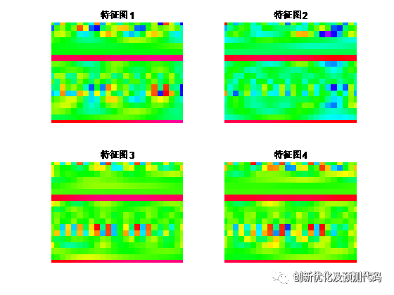
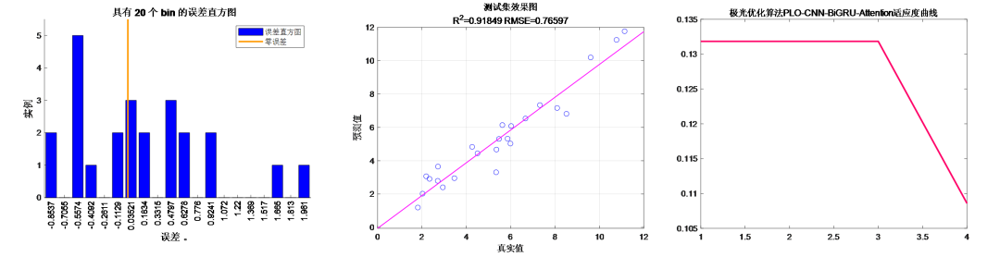

# Polarized Light Optimization PLO-CNN-BiGRU-Attention Spatio-Temporal Feature Fusion Attention Mechanism Prediction Program Code! Run directly!

Applicable Platform: Matlab2023 and above
Polar Lights Optimizer (PLO), published in the journal of Neurocomputing on August 28, 2024. This algorithm has not been applied in any literature recently, so it's first-come, first-served! Seize this innovation opportunity!
We utilized PLO to optimize hyperparameters in our CNN-BiGRU-SelfAttention time-series and spatial feature combination - fused multi-head self-attention mechanism regression prediction program code.
This paper introduces a novel metaheuristic algorithm named Polar Lights Optimizer (PLO), which is mainly based on physical phenomena, simulating the motion trajectory of high-energy particles in solar wind.
Through the use of 29 typical CEC2017 unconstrained benchmark problems and 22 real-constraint optimization problems from CEC2020 for verification, it also compared with traditional AO, MVO, EO, AVOA, HHO, PSO-sono, SHADE, LSHADE-SPACMA, and validated the optimization capability of SAO. In addition, to further verify its advantages, the author also applied SAO to extract core parameters of photovoltaic systems. The results showed that the developed LPO performed better than other advanced optimization methods.
The innovative points of PLO are mainly reflected in the following aspects:
Rotational motion model based on physical laws: PLO algorithm introduces a unique rotational motion model that simulates the deflection of high-energy particles by the Earth's magnetic field and their collision with atmospheric molecules. This model helps particles carefully search for optimal solutions during the local exploitation phase through physical laws, and gradually improves the convergence accuracy during the algorithm iteration process. This simulation based on physical laws provides a new way to solve optimization problems.
PLO algorithm: The Particle-Oriented Local Optimization (PLO) algorithm introduces the polarized elliptical walk strategy, which simulates the phenomenon of high-energy particles gradually converging in the polar ionosphere and forming a glowing elliptical ring. The particles move freely within this elliptical ring and follow the Earth's magnetic field in a chaotic manner. This strategy allows high-energy particles to search the entire space dynamically with a step size, guided by the centroid of the particle population to ensure convergence direction throughout the particle population, thereby enhancing global search capability.
Particle collision strategy: The PLO algorithm also incorporates a particle collision strategy, simulating the disorderly collision behavior of high-energy particles throughout their flight. This strategy enhances the algorithm's ability to escape local optima, making it more robust in complex optimization spaces with stronger global exploration and local development capabilities.
Parameter-free optimization: Unlike many algorithms that require additional predefined parameters, the PLO does not require any extra parameters. This makes the PLO significantly advantageous for applications on complex problems, simplifying the algorithm's application and reducing the need for specific problem-specific parameter adjustments.
Balancing global exploration with local development: The PLO algorithm achieves a balance between global exploration and local development through the combination of rotational motion and polarized elliptical walk strategies. By adjusting the search step size and the exploration space strategy, the PLO can gradually explore the global optimal solution at the early stages of the search process while accumulating experience to gradually improve the precision of local area development.
Summary: The PLO is an inspired metaheuristic algorithm inspired by the polar phenomenon. It designs three main strategies: rotational motion, polarized elliptical walk, and particle collision, respectively for local search, global search, and avoiding local optima. The mathematical model of the PLO introduces innovative elements such as Lorentz force, Newton's second law, damping factor, and adaptive weights, achieving dynamic balance between global and local search, improving the effectiveness and accuracy of the optimization algorithm.
Innovativeness of CNN-BiGRU-SelfAttention model:
① Integrating Convolutional Neural Networks (CNN) and Bidirectional Gated Recurrent Units (BiGRU): CNNs are used for processing multi-variable time series with multi-channel inputs, effectively capturing the spatial relationships between input features. BiGRUs are recurrent neural networks capable of capturing long-range dependencies in sequences. Through bidirectionality, BiGRUs can consider both past and future information simultaneously, enhancing the model's ability to perceive dynamic changes in time series.
② Introducing Multihead Self-Attention Mechanism: The Multihead Self-Attention mechanism allows the model to more flexibly weight different time steps' input information. This helps the model focus more on time points that have a greater impact on the prediction target. The self-attention mechanism also aids in handling long-term dependencies in time series, improving the model's global information perception during prediction.
Optimization Approach: A forward-looking 24-step multivariate time series regression prediction algorithm based on the Lightning Optimizer (LPO), Convolutional Neural Networks (CNN), and Bidirectional Gated Recurrent Units (BiGRU) integrated with the Multihead Self-Attention mechanism.
Function:
- Input of multivariate features, single sequence variable output, inputting the feature of the previous day to predict the next day, achieving a forward-looking 24-step prediction.
- Optimizing learning rate, convolution kernel size, and number of neurons through PLO optimization algorithm, aiming to minimize MAPE as the objective function.
- Providing loss, RMSE iteratively changing polar coordinates graph; network feature visualization graph; test comparison graph; fitness curve (if the initial precision is highest, then the fitness curve is a horizontal line).
- Providing MAPE, RMSE, MAE, etc., for calculation results display.
Applicable Fields: Prediction of wind speed, photovoltaic power, power generation, carbon price, etc.
Dataset Format:
The previous day, 18 meteorological features such as temperature, humidity, dew point, etc., were sampled for a period of 24 hours, and the output was the power generation for the next day's 24-hour period, which is equivalent to an input of 18×24 and an output of 1×24, totaling 75 such samples.
Comparison between predicted values and actual values:
Training feature visualization:
An elliptical form of the training error curve (error decreasing from inside outwards) indicates the process of error reduction:
Fitness curve:
Stay tuned for updates on high-innovation, high-quality learning materials, articles, and code, supporting your research endeavors!

## Images

<!-- PAYMENT_BLOCK -->

## Get this dataset

- Payment link (Stripe): [Buy now](https://buy.stripe.com/3cs8yP7sY87d0vu9AB)
- Payment QR code: 

<!-- /PAYMENT_BLOCK -->
